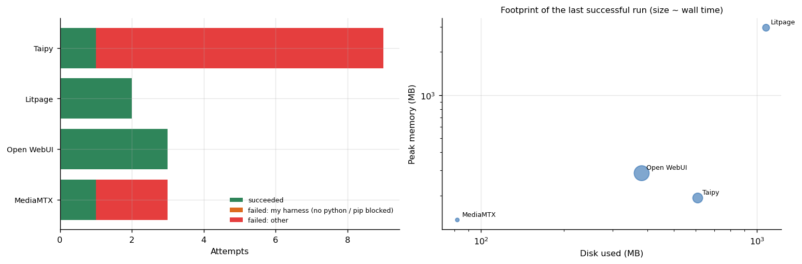

# App platforms: smoke tests

**Can this open source platform be brought up on a small CPU machine and answer a request?** Taipy, Litpage, Open WebUI and MediaMTX, each installed from scratch in a disposable sandbox, started, and probed. A smoke test with every attempt and every failure kept.



## Why this matters

Before building on an open source platform you want to know three cheap things: does it install from a clean machine, how much memory and disk does it take, and does it actually answer. This lab gives those answers with the test script for each platform (`src/tools/*.sh`) so they are reproducible, and with the number of attempts each one needed, which is usually the most telling figure.

## Results

| Platform | Check | Result |
|---|---|---|
| Taipy (Python web apps) | start a minimal app, `curl` it | HTTP **200**; whole script 112 s, 192 MB peak memory. Needed several attempts before the check waited long enough for the server |
| Litpage | install, build and serve | HTTP **200**; 54 s, **2,954 MB** peak memory (the build is the heavy part) |
| Open WebUI | `pip install` and serve | script finished with exit status 0; whole script 257 s, 382 MB on disk. The harness's readiness metric for this tool printed a shell template instead of a number (a bug in my test script), so only the script time is reported |
| MediaMTX (RTSP server) | start the server, publish a synthetic stream, probe it with `ffprobe` | first answer after **5,328 ms** (H.264, 1280x720, 15 fps); 135 MB peak memory |

These are install-and-answer checks, not performance tests. No load was applied to any platform.

## What it took

4 of 4 platforms came up. Of 17 attempts, 7 succeeded; 0 failures were the harness and 10 were something else (a server that was slower to start than the check allowed, an RTSP publisher whose pipe broke). See `results/tables/failure_classes_by_tool.md`.

## Repository map

```
src/sandbox/sandbox_suite.py   the harness (isolated HOME, time limit, peak RSS, disk, METRIC parsing)
src/tools/*.sh                 the test script of each platform
analysis/tools_report.py       attempts, failure classes, footprints, figures
data/                          sandbox_attempts.csv, sandbox_metrics.csv
```

## Reproduce

```bash
make setup && make all
python src/sandbox/sandbox_suite.py taipy litpage open_webui mediamtx
```

## Limits

Exit status 0 plus the printed check is the only criterion. Security, licensing, upgrade path and behaviour under load were not examined, and the platforms change: the repositories were at their latest commits on 26 October 2026.

## Articles that use this repository

- [Eighty-three open tools in a disposable sandbox](https://www.kaggle.com/code/lucasrangelss/eighty-three-open-tools-in-a-disposable-sandbox)
- [How many cameras can one RTX 5090 serve](https://www.kaggle.com/code/lucasrangelss/how-many-cameras-can-one-rtx-5090-serve) uses MediaMTX as its camera source
- Related: [web-automation-lab](https://github.com/LucasRangelSSouza/web-automation-lab), [agent-tooling-token-savings](https://github.com/LucasRangelSSouza/agent-tooling-token-savings)

Licence: MIT for this code; see `LICENSE_NOTES.md` for each platform.
